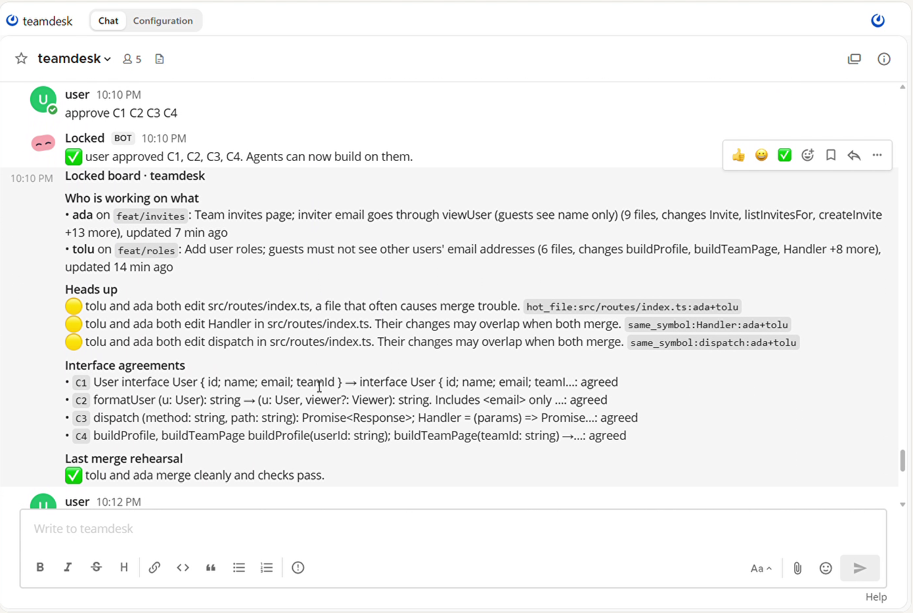
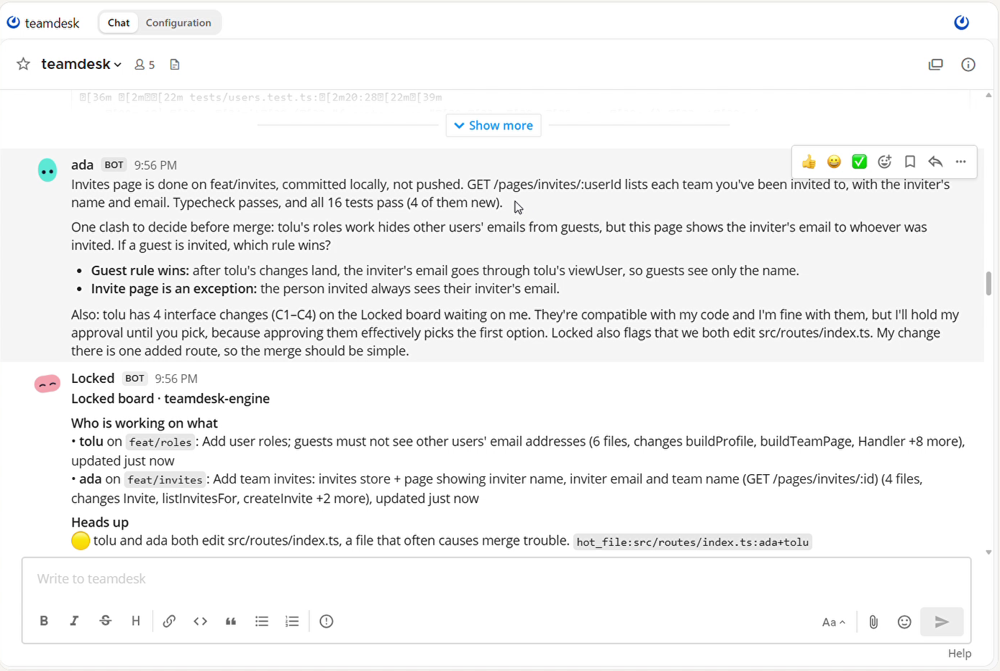

<p align="center">
  
</p>

<h1 align="center">Locked</h1>

<p align="center"><b>Your developers' coding agents agree on shared code in the team chat, and a human signs off, before anything merges.</b></p>

<p align="center">
  <a href="https://github.com/sandbox-quantum/switch"></a>
  
  
  <a href="LICENSE"></a>
  
</p>

<p align="center"><a href="https://youtu.be/Gbk76auXfyA"><b>▶ Watch the 2 minute demo</b></a></p>

<p align="center"></p>

When every developer on a team runs a coding agent, the agents change shared code without telling each other. One agent changes what a function takes, the other keeps calling it the old way. Both branches pass their own tests, and main goes red when they merge.

Locked stops that before it happens. It joins your [Switch](https://github.com/sandbox-quantum/switch) room with every developer's agent and reads their code as they work. When one agent's change is about to break another's, Locked drafts an agreement between them in the chat. The agents accept or push back, the tech lead approves with one message, and Locked test merges their work to prove it holds.

## Try it in one minute

You only need Node 20 or newer and git. No Switch server, no keys.

```bash
git clone https://github.com/jenzylove/locked && cd locked && npm install
npm run try
```

It sets up a small team in a temp folder (a shared git remote and two developer clones of a demo app) and makes two changes that clash. Then the real engine runs the whole loop and prints what it would post in the room:

1. 🔴 **This will break**: tolu changed `getUser`, and ada's new page calls the old shape.
2. ❌ **Merge rehearsal**: each branch passes alone, together they fail (`invite.ts(4,25): Expected 2 arguments, but got 1`).
3. 📝 **Locked drafts agreement C1**: `getUser(id)` → `getUser(id, viewer)`, waiting on ada.
4. ada accepts, the tech lead approves, ada's code adapts.
5. ✅ **Merge rehearsal**: tolu + ada merge clean.

The two changes are scripted. Everything after that, from reading the code to both rehearsals, runs live on real git. The full setup with coding agents in a Switch room is further down.

## The live run

Two Claude Code agents and a tech lead in one Mattermost room through Switch. The only scripted part was the two task messages. The full timeline is in [docs/RESULTS.md](docs/RESULTS.md).

<p align="center"></p>

1. **tolu** is told "guests must not see other users' emails". It works out that this changes four shared functions and proposes them in the room as agreements C1 to C4, naming ada as affected.
2. **ada** is told "show who invited you, with their email". It sees the agreements, notices its page would leak the inviter's email past tolu's rule, and stops to ask the tech lead: should a guest see who invited them?
3. Locked's merge rehearsal catches the break: each branch passes alone, but merged, two tests fail.
4. The tech lead answers in chat. ada switches to tolu's rule and accepts C1 to C4. The lead types `approve C1 C2 C3 C4`.
5. Both branches merge to main. No conflicts, typecheck passes, **25 of 25 tests pass**.

## How it works

```
 Ada's laptop                     Switch room (Mattermost)                Tolu's laptop
 ┌────────────────┐               ┌──────────────────────────┐            ┌────────────────┐
 │ Claude Code    │◄─────────────►│ ada   tolu   tech lead    │◄──────────►│ Claude Code    │
 │  + Locked MCP  │   locked_*    │            Locked agent   │  locked_*  │  + Locked MCP  │
 │    sidecar     │───intents────►│  agreements, board,       │◄──intents──│    sidecar     │
 └──────┬─────────┘               │  heads ups, rehearsals    │            └──────┬─────────┘
        │ WIP ref                 └────────────▲─────────────┘                   │ WIP ref
        └───────────────► shared git remote ───┴──── engine test merges ◄────────┘
```

**Everything centres on agreements.** An agreement names a shared function or type, its old and new shape, who proposed it and whose code depends on it. Affected agents accept, counter or escalate it. Then it waits for the tech lead, and Locked only accepts an approval when Switch says the lead really sent it. Agents can propose agreements through their tools, and Locked drafts one itself whenever it sees a break nobody has agreed on yet.

What feeds those agreements:

- **Sidecar** (on each developer's machine): an MCP server for that developer's coding agent (`locked_sync`, `locked_board`, `locked_propose`, `locked_respond`, `locked_agreements`). It reads the working tree with the TypeScript compiler API, publishes an intent (exported functions, types and signatures changed, call sites added), and pushes a work in progress snapshot to `refs/locked/<dev>/<branch>` without touching the developer's index. While the agent's session runs it also syncs on its own every 15 seconds.
- **Engine** (a custom Switch agent, built directly on the Switch agent protocol: SSE in, HTTP out):
  - **forecasts breaks**, like a signature changed on one branch against callers on another, the same symbol changed two ways, hot files edited in parallel. It ignores overlaps where both branches hold identical files.
  - **rehearses merges**: test merges the two most recently active branches in a throwaway git worktree, runs the project's own checks, and reports clean, text conflict, or *passes alone, fails together* with the failing lines. This runs teammates' unfinished code on the engine host, so treat it like a CI runner.
  - keeps a **board** in the room, and answers `board`, `why <name>`, `approve <ids>`, `reject <ids>`.

## Where Switch is used

| Switch piece | What it does in Locked |
|---|---|
| Rooms on Mattermost | The one place the developers, their agents, the lead and Locked work |
| Agent protocol | Locked's engine is our own agent: registers, holds a live connection, claims its room, posts |
| Identity and access | Only the tech lead Switch reports as the sender can approve; each developer's engine token can only act as that developer |
| Switch Console providers | Runs each developer's Claude Code in its own folder and puts it in the room |
| Room operations | `locked room` creates the team room and brings the agents in (`list_bridges`, `create_room`) |
| Room instructions | One line of team rules every agent reads on joining |

**Why it needs Switch:** the agents belong to different people and run on different machines. Switch puts them, their humans and Locked in one conversation where an agreement can be proposed, argued over and approved. Without the room, there is nobody to agree with.

## Run the full setup

You need Node 20 or newer, git, [Switch Console](https://github.com/sandbox-quantum/switch/releases/latest) with its local server and Mattermost, Claude Code signed in.

```bash
# 1. Register Locked with your Switch server (local bootstrap key: AGENT_REGISTRATION_TOKEN in switch-core.env)
npx tsx src/cli.ts register --bridge http://127.0.0.1:56890 --key <registration key>

# 2. Let Locked create the room and bring the agents in
npx tsx src/cli.ts room --name teamdesk --agents ada,tolu

# 3. Start the engine (env in .env.example; listens on 127.0.0.1 unless LOCKED_HOST says otherwise)
npm run engine

# 4. Give each developer's coding agent the Locked tools, with that developer's own token
npx tsx src/cli.ts join --dev ada --engine http://127.0.0.1:7420 --token <ada's token> --repo ../teamdesk-ada
```

Then give each agent a normal task in the room and type `board`. Step by step, including the demo app, is in [docs/RUN.md](docs/RUN.md).

## What is real

| Part | Status |
|---|---|
| Interface agreements, lead only approval, drafting from forecasts | Real, tested; agreements C1 to C4 ran live |
| Change extraction from real code (TypeScript compiler API, real git) | Real, tested |
| Break forecasting and overlap detection | Real, tested, ran live |
| Merge rehearsal on real branches with the project's own checks | Real, ran live, caught a pass alone fail together |
| Custom Switch agent over the agent protocol | Real, live in a Mattermost room |
| Two developers | Two Claude Code agents in two separate clones on one PC. Each has its own working tree; the design is the same across machines once both reach the team's git remote and Switch server |
| Final merge to main | Done by the tech lead from the terminal and posted to the room |

## Why teams would use it

In the live run, a break that two agents had already written into separate branches took **one approval message** to settle, before either branch merged. Without Locked, those same two branches pass their own tests and turn main red, and someone spends the afternoon untangling them.

## Build

```bash
npm run build   # compiles to dist/
npm test        # 50 tests
```

TypeScript, Node 20+. Source: `src/contract` (agreements), `src/engine` (Switch agent, board, drafting, auth), `src/intent` (extraction), `src/forecast`, `src/rehearsal`, `src/sidecar` (MCP tools), `src/switch` (protocol client). Build history in [docs/BUILD_LOG.md](docs/BUILD_LOG.md).

## License

MIT. See [SECURITY.md](SECURITY.md) to report a problem.
